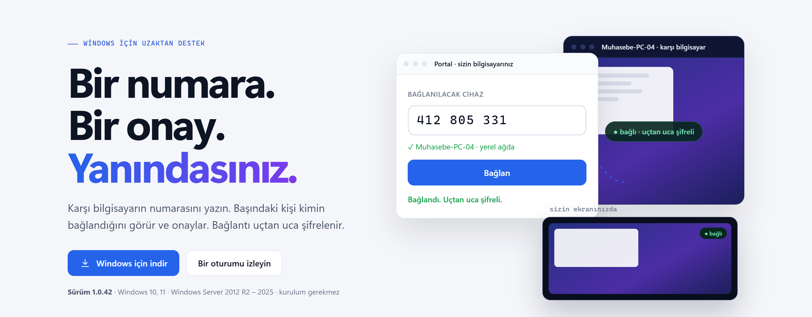
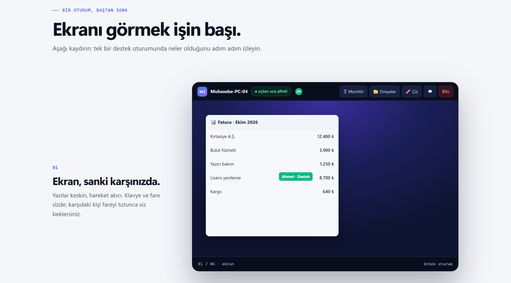
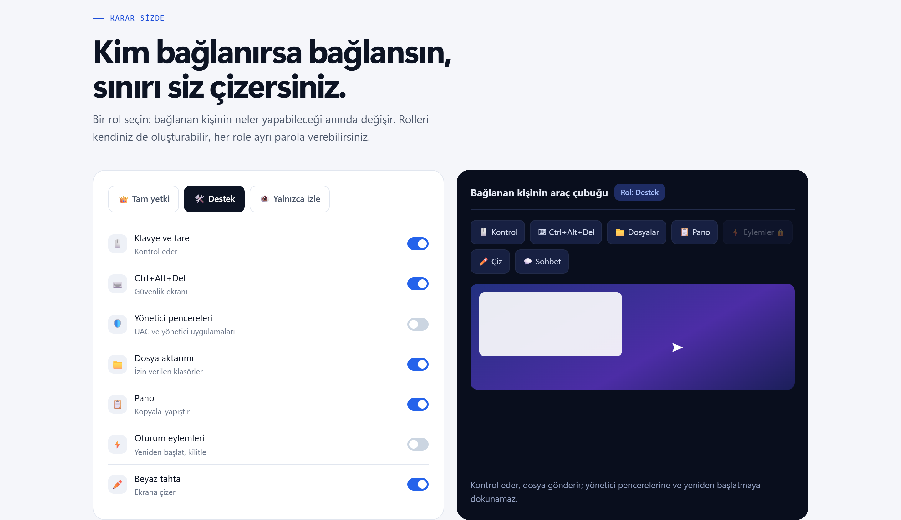
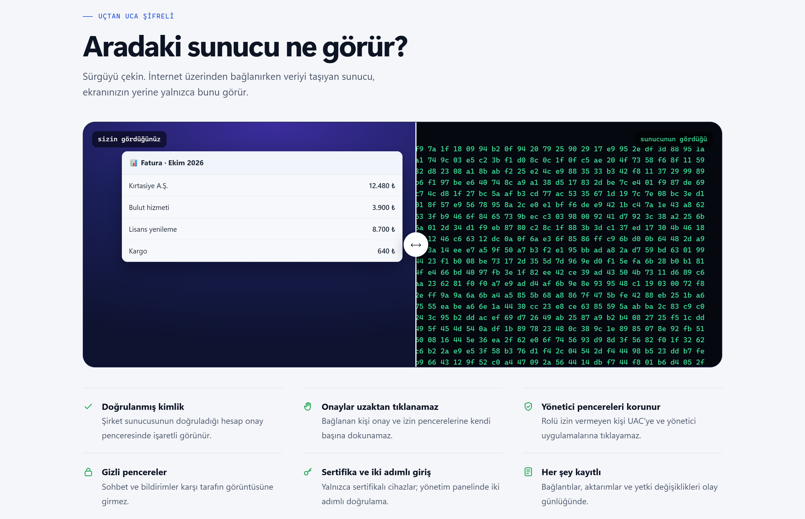
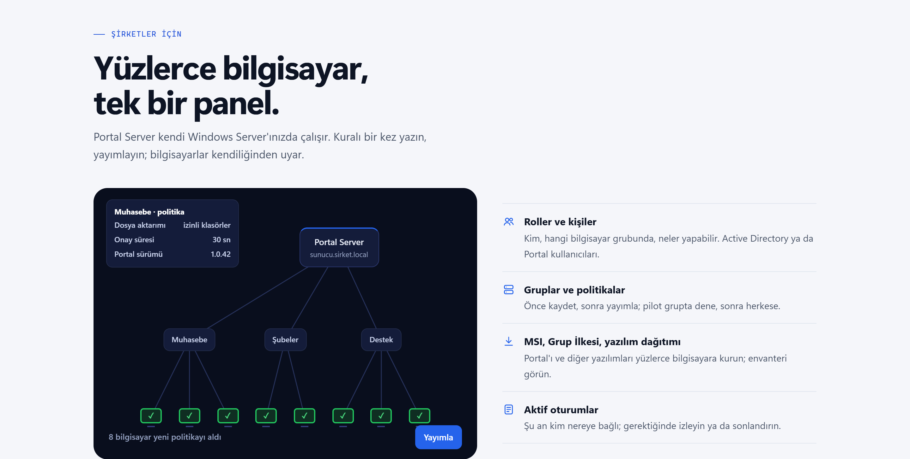
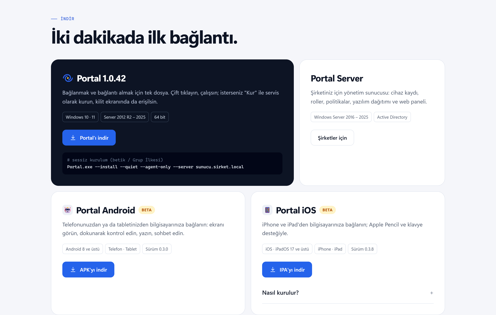

  

<h1 align="center">Portal</h1>

  <b>Windows için uzaktan destek.</b> Bir numara, bir onay, yanındasınız. 
  <a href="https://remoteportal.app">remoteportal.app</a> · <a href="https://remoteportal.app/#indir">İndir</a> · <a href="https://remoteportal.app/#sss">SSS</a>

> Bu depo yalnızca **tanıtım** içindir. Portal'ın kaynak kodu paylaşılmaz; indirmeler ve güncel bilgiler
> [remoteportal.app](https://remoteportal.app) adresindedir.

## Portal nedir?

Portal, karşı bilgisayarın numarasını yazıp bağlandığınız bir uzak masaüstü uygulamasıdır. Bilgisayarın başındaki kişi kimin
bağlandığını görür ve onaylar; bağlantı uçtan uca şifrelenir. Tek dosyadır: kurmadan çalıştırabilir, isterseniz servis olarak
kurup kilit ekranında da erişebilirsiniz.

## Öne çıkanlar

- **Ekran ve kontrol:** keskin yazılar, hareketli bölgelerde donanım hızlandırmalı H.264, çoklu monitör, Ctrl+Alt+Del.
- **Birlikte çalışma:** sohbet, beyaz tahta ve ekrana çizim, pano, karşı bilgisayarın sesi, aynı anda birden fazla kişi.
- **Dosyalar:** yalnızca izin verilen klasörler, kaldığı yerden devam eden aktarım, SHA-256 doğrulaması.
- **Oturum eylemleri:** yeniden başlat, güvenli kip, kilitle; karşıdaki kişinin onayıyla.
- **Bağlantıyı çevir:** tek tıkla karşıdaki kişi sizin ekranınızı görür.
- **Her yerden:** aynı ağda doğrudan, internet üzerinden numarayla; mümkünse görüntü doğrudan (NAT delme).

## Kim bağlanırsa bağlansın, sınırı siz çizersiniz

Bağlanan kişinin neler yapabileceğini rollerle ya da tek tek izinlerle siz belirlersiniz. Her role ayrı parola verilebilir;
yönetici olarak çalışan pencereler, rolü izin vermeyen kişiden korunur.

## Güvenlik

İnternet üzerinden bağlanırken veriyi taşıyan sunucu ekranınızı göremez: bağlantı iki uç arasında şifrelidir. Onay ve izin
pencereleri uzaktan tıklanamaz; sohbet ve bildirim pencereleri karşı tarafın görüntüsüne girmez.

## Şirketler için

**Portal Server** kendi Windows Server'ınızda çalışır: cihaz kaydı, gruplar ve politikalar, roller ve atamalar (Active Directory ya
da Portal kullanıcıları), aktif oturumlar, yazılım dağıtımı ve envanter, web panelinden tarayıcıyla bağlanma. Portal MSI ile ve
Grup İlkesi ile dağıtılır; yeni sürümler panelden yayımlanır, bilgisayarlar kendiliğinden güncellenir.

## İndir

| | Platform | Durum |
|---|---|---|
| **Portal** | Windows 10, 11 · Windows Server 2012 R2 – 2025 · 64 bit | Kararlı |
| **Portal Android** | Android 8 ve üstü · telefon ve tablet | Beta |
| **Portal iOS** | iOS / iPadOS 17 ve üstü · iPhone ve iPad | Beta |

İndirmeler yalnızca [remoteportal.app/#indir](https://remoteportal.app/#indir) adresinden yapılır.

## Telif ve kullanım

© 2026 Portal App / Muhammed Ali DEMİRCİ. Tüm hakları saklıdır.

Bu depodaki metin ve görseller yalnızca Portal'ı tanıtmak içindir; herhangi bir açık kaynak lisansıyla sunulmaz. Portal'ın
kullanım koşulları [Telif hakkı ve kullanım](https://remoteportal.app/telif.html), kişisel verilerle ilgili bilgiler
[Gizlilik](https://remoteportal.app/gizlilik.html) sayfasındadır.
